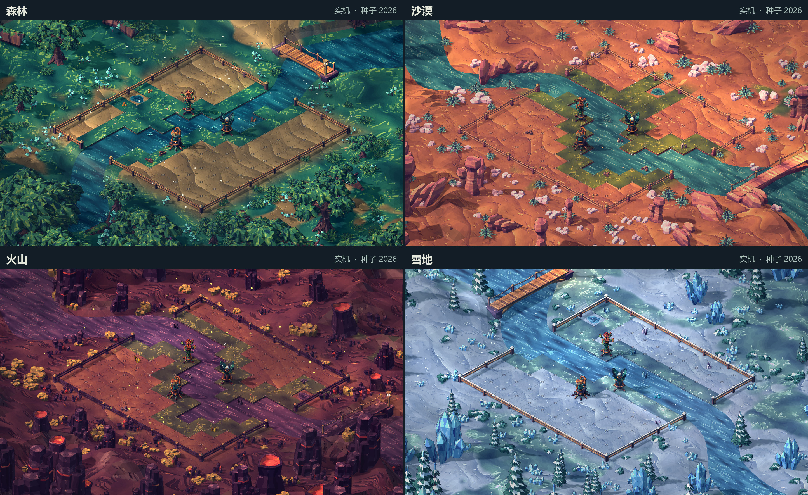

# 归档计划 / Project Archive

归档计划（Project Archive）是一款使用 Godot 4.7.2 制作的地块经营游戏。四个地区都在三维世界中生成，河道与地形从 11×11 个可操作地块延伸到远处。地块、植被与机器接受同一组灯光和实时投影。打开 project.godot 后按 F5 运行。

## 生灵系初始机器

在空地按住右键，拖向「投放生灵点」后松开。也可以选中地块，在详情面板投放或追加。三台 FT1 机器均需要至少 1 点地块支撑。选中成体可看作用范围、工作状态和累计产量。按 Esc 打开机器图鉴可以旋转模型。

| 机器 | 培育操作 | 潮汐结束时的作用 |
| --- | --- | --- |
| 播种器 | 投 1 点，等 5 秒，再生长 10 秒。落点生灵浓度 ≥ 0。 | 将上下左右的地块播种为草地，各加 1 点生灵浓度并稳固。 |
| 收集器 | 5 秒内追加第 2 点，随后等 10 秒，再生长 10 秒。落点浓度 ≥ 1。 | 四邻浓度总和每满 8 点获得 1 点生灵，向下取整。 |
| 提取器 | 5 秒内追加第 2 点，随后 10 秒内追加第 3 点，再生长 10 秒。 | 从周围八格中每个正浓度地块抽取 1 点，每累计 8 点产出一罐液态能量。 |

每台机器都要求范围内至少有一格生灵浓度 ≥ 0。播种器和收集器自体供能，提取器由潮汐供能。机器按播种、收集、提取的顺序结算。稳固持续阻止地块翻转与转变，潮汐仍能改变浓度。提取余量、培育分支和进度随存档保存。

## 棋盘与操作

- 低矮围栏围出 11×11 格工作区。河道在两侧河口与外围地形相接，桥位随河道生成。[两个种子的满水与退潮实景](docs/work-area-tides.jpg)
- 默认每 30 秒从随机边缘开始一次潮汐，经过的地块增加 1 点生灵浓度。设置中可调整间隔。沙地与草地可成对翻转。河道随世界种子和地区生成。退潮时河心变为低水位河流，浅滩露出河床。下一轮涨潮重新淹没河床并冲走其上的机器。
- 生灵视图按机器实际使用的有符号浓度着色。在地块详情中还可以凝聚自然能量或清理附着物。
- WASD 平移，Q/E 旋转，滚轮缩放，V 切换属性视图，Delete 拆除机器，F5 保存，F9 读取。选中机器后也可以通过右键菜单打开它的图鉴、暂停或拆除。
- 运行时的三台机器与五个生长阶段位于 `assets/models/flora/`。建模源文件在 `tools/machine_models/`，图鉴立绘与预览图集在 `assets/machines/baked/`。旧机器的模型与贴图保留在工程内。

[同机位像素材质更新对照](docs/hd-pixel-before-after.jpg) · [森林近景实机原图（1920×1080）](docs/native-detail-1080.png)
