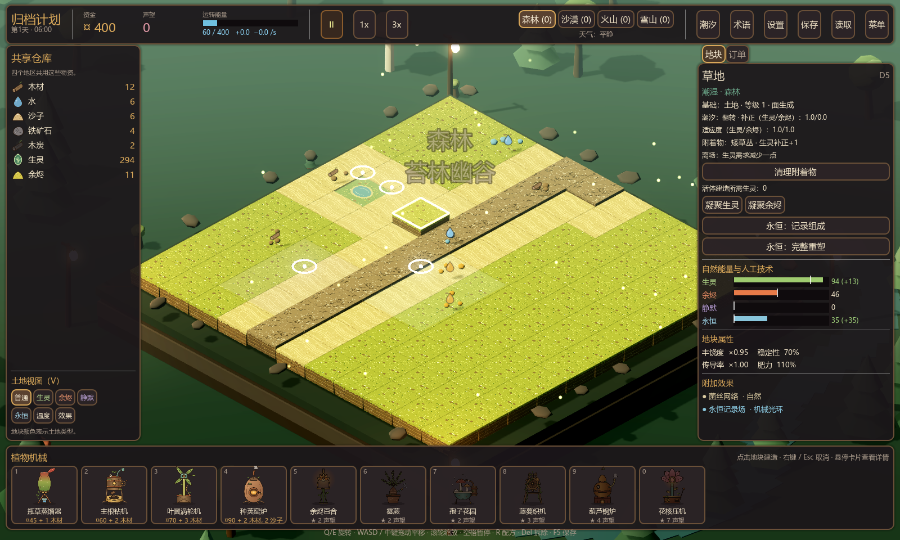

# 归档计划 / Project Archive

归档计划（Project Archive）是一款使用 Godot 4.7.2 制作的地块经营游戏。汇聚生灵与余烬，以静默融合自然，以永恒记录与重塑。打开 project.godot 后按 F5 运行。

- **生灵、余烬**：自然能量。地块具有独立浓度，可凝聚为库存能量；生灵分化植物组织，余烬分化矿石与金属。
- **静默、永恒**：人工技术，自然地块不会随机带有技术强度。藤蔓织机提供静默融合场及融合配方；花核压机提供永恒记录场，在作用范围内可记录与重塑地块、附着物、自然能量和机械组成。缺失或不同的机械按建造资金与材料支付重塑费用。
- **基础地块与变体**：基础类型下包含不同种类、不同等级的变体。附着物与具体变体绑定。
- **潮汐**：周期性浪潮，从随机边缘逐排推进，交替补充或抽离自然能量。间隔在设置中编辑，也可手动触发。
- **翻转**：显式成对对应，地块抬升后上下翻转180度。当前为沙地↔草地、河流↔河床。
- **转变**：从同基础类型、同等级的其他变体抽取，不使用翻转动画。可在地块规则中将潮汐模式设为“转变”。

主菜单和游戏顶部的“术语”入口包含完整世界定义。温度由独立热度与湿度决定，原有运转能量仍用于机械供能。地块自然能量与人工技术强度影响速度、产量、能耗、磨损。

11×11棋盘铺满独立六面地块模型，入场时波浪式升起，选中时高亮并抬升。支持简体中文、英文及可编辑设置、保存和读取。

WASD平移，Q/E旋转，滚轮缩放，V切换属性视图，1–0建造，R切配方，Delete拆除，F5保存，F9读取。源码、数据、模型分别位于 scripts/、data/、assets/。

按住地块上的右键呼出四向环形菜单，拖向选项后松开执行；中心松开、拖到菜单之外或按Esc取消。机械菜单为上方详情、右侧配方、下方拆除、左侧暂停/继续；空地菜单提供详情、清理附着物与自然能量凝聚。不适用的选项置灰。

